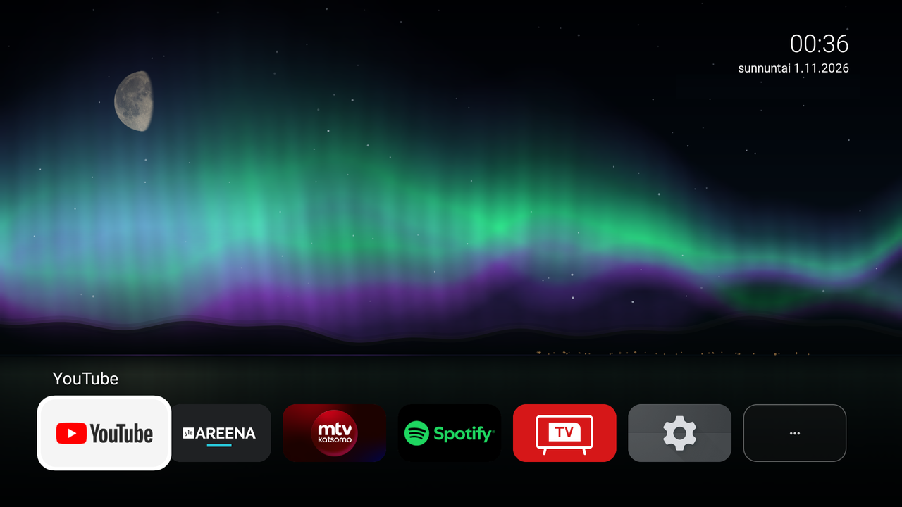

# Aurora

A tiny, ad-free home screen for the **TCL Google TV "G10"** with a slow, soft northern-lights scene that follows the
real moon phase. It replaces the stock Google TV launcher (and its ads and recommendations) with a clock, the weather
and one row of your apps.



* Animated aurora, snowy ridge, lit town, frozen lake, stars, occasional shooting star and a distant snowmobile.
  Nothing changes faster than about once every two seconds and nothing flashes.
* A moon drawn from a set of real-looking phase pictures, picked by the **actual lunar phase** from the date.
* Clock, date and weather (Open-Meteo, no API key) top right.
* One ribbon of apps along the bottom; the cards shrink so every app always fits. Hide, show and re-order apps from
  the "..." tile (or the remote's **Menu** key); long-press OK on an app to pick it up, up/down to move it.
* Small and light: plain Java, no libraries, about 0.5 MB, drawn at ~25 fps on a 32-bit ARM TV.

## Tested hardware (only this one)

| | |
|---|---|
| TV | TCL "Smart TV", product `G10_4K_GB_NF_32BIT` |
| OS | Google TV on Android 12 (API 31), 32-bit ARM (`armeabi-v7a`), ~1.8 GB RAM |
| Build | `STT2.230203.001`, security patch 2025-12-05, **locked bootloader** |
| Remote | `BT_RC833A_B5` (USB id 0417:0304), Bluetooth plus IR |

Other TCL models, or other Google TVs, may have different key codes and package names. The commands and the table
below show how to find yours.

> **Read this first.** Setting this up disables two system packages and turns on an accessibility service. It is
> reversible (see [Undo](#undo)) and the scripts re-enable the stock launcher if anything goes wrong, but it was
> only ever tried on one TV. You do this at your own risk.

## Download

A pre-built APK is on the [Releases page](https://github.com/Ceziar/aurora-tv-launcher/releases) (about 0.5 MB, signed
with the standard Android *debug* key, so it is for sideloading with `adb`, not for an app store). Its SHA-256 is in the
release notes; check it with `Get-FileHash aurora-1.0-debug.apk` (PowerShell) or `sha256sum aurora-1.0-debug.apk`.
If you would rather not run someone else's binary, build it yourself: it is two plain Java files and takes a minute.
The app asks for two permissions: *Internet* (only for the weather) and *query all packages* (to list your apps).

## What you need

* ADB over the network: on the TV, Settings > Device Preferences > About, tap *Build* seven times; then Developer
  options > *Network debugging* (on this TV it is switched off again after every cold reboot).
* [`adb`](https://developer.android.com/tools/releases/platform-tools) on your PATH. The scripts are Windows PowerShell; the
  `adb` commands they run are listed below if you use another OS.
* To build: JDK 17 and the Android SDK (`platforms;android-34`, `build-tools;34.0.0`). Put
  `sdk.dir=/path/to/sdk` in `local.properties` (it is git-ignored).

## Install

### Guided (recommended)

```powershell
powershell -ExecutionPolicy Bypass -File tools\install-wizard.ps1
```

The wizard walks through five steps and **stops at each manual one until it has checked that you did it**: Network
debugging on, the "Allow debugging" prompt accepted, the APK present, Aurora made the home app, and the accessibility
service ticked. It saves a snapshot of the settings it may change, then offers a few optional tweaks (all off by
default). `install-wizard.ps1 -Undo` puts everything back. The manual commands below do the same thing.

### Manual

```powershell
.\gradlew.bat assembleDebug          # ./gradlew assembleDebug on macOS/Linux; skip this line if you downloaded the APK
adb connect 192.168.1.50:5555         # your TV's address
adb -s 192.168.1.50:5555 install -r app/build/outputs/apk/debug/app-debug.apk   # or the path of the APK you downloaded
.\tools\restore-tv-config.ps1 -TvAddress 192.168.1.50:5555
```

Then switch the accessibility service on yourself (the script never does that for you, it is a security setting):
**Settings > Device Preferences > Accessibility > Aurora remote keys > On**, and run the script once more.

`restore-tv-config.ps1` is safe to re-run any time. It does the following, and rolls back to the stock launcher if
Home would not land on Aurora:

1. Makes Aurora the home app (`cmd role add-role-holder --user 0 android.app.role.HOME io.github.ceziar.aurora 0`,
   after handing the role back and re-setting it with `cmd package set-home-activity`; the order matters).
2. Disables the stock launcher: `pm disable-user --user 0 com.google.android.apps.tv.launcherx`.
3. Disables the setup-recovery package: `pm disable-user --user 0 com.google.android.tungsten.setupwraith`.
4. Turns the screensaver off (`settings put secure screensaver_enabled 0`, plus the sleep and dock variants).
5. If you already ticked the accessibility service, restarts it (see the cold-boot note below).

`tools/check-tv-config.ps1 -TvAddress <ip>:5555` does the same checks and **changes nothing**.

### Make it yours

In `MainActivity.java`: `LOCATION_NAME`, `LAT`, `LON` (weather); `DEFAULT_ORDER` and `DEFAULT_HIDDEN` (first-run app
order and the TCL helper apps that start hidden). Two things to know: the dialog text and the weather words are in
**Finnish**, written inline in that file, and the moon is drawn for the northern hemisphere (waxing = lit on the right).

## The remote keys

With the stock launcher gone, some remote keys stop working: TCL's own shortcut handler (`TclShortCutKeyManager`)
answered them through the launcher. The accessibility service (`RemoteKeyService`) sees the keys first and answers instead:

| Key | Linux scan code | Now opens |
|---|---|---|
| Home | `KEYCODE_HOME` | Aurora (explicit intent) |
| YouTube button | 245 (`KEY_DISPLAY_OFF`) | YouTube |
| Gear button | 233 (`KEY_FORWARDMAIL`) | full TV Settings |
| TV (guide) button | 365 (`KEY_EPG`, `KEYCODE_GUIDE`) | TCL's TV app |

The coloured app buttons (Netflix 242 Bluetooth + 566 IR, Prime 752, film-strip 236, TCL Channel 227, Disney+ 762) kept
working natively. If you want them to open something else, uncomment their lines in `RemoteKeyService.java`.
**To find the codes on your own remote:** `adb shell getevent -lt`, press a button, and read the `KEY_...` line; or press
it and read `adb logcat -d -s RemoteKeys`, which prints every unmapped media key it sees.

> **Removing an app breaks its button.** If you uninstall or disable an app that has a button on the remote (Netflix,
> Prime Video, Disney+, YouTube), pressing that button opens the app's Play Store page instead. Keep those apps, or
> point the button at something else in `RemoteKeyService.java` (the optional lines above).

## Optional tweaks

None of these are needed for Aurora; the wizard offers them and can undo them.

* **Animations off:** `adb shell settings put global window_animation_scale 0` (and `transition_animation_scale`,
  `animator_duration_scale`). Same as Developer options > "Window/Transition/Animator animation scale: off".
  Menus feel much snappier on this slow TV.
* **TCL helper apps** (sticker, phone-connect, home helper, shop mode, Alexa helper, content feed): the wizard can
  disable them one at a time with `pm disable-user --user 0 <package>` and re-enable them with `pm enable <package>`.
  Not all TV functions are documented, so it asks per app. Do not disable `com.tcl.ttvs` (keyboard, casting, menus).

## After a cold reboot

The settings stored on the TV survive, but this firmware resets Android's accessibility master switch at boot (and
occasionally without a reboot), so the service is ticked yet not running; Home still works, because Aurora is the only
home screen left, but the remapped buttons do not. Switch Network debugging back on, run `check-tv-config.ps1`, and if
it reports anything run `restore-tv-config.ps1`, which restarts the service. After installing a new build, run the
restore script once too.

**Optional self-repair (`ServiceGuard`).** Grant Aurora one extra permission once and it fixes this itself:

```
adb -s <ip>:5555 shell pm grant io.github.ceziar.aurora android.permission.WRITE_SECURE_SETTINGS
```

(The restore script also sets the `APP_AUTO_START` app-op to `allow`. This TV's own `TclAppBoot` otherwise refuses to
let the system start the service whenever Aurora's process is not running, which is the usual reason the remote
buttons stop working after a reinstall or a memory kill; the log line is `callee_doesn't_have_OP_AUTO_START_permission`.)

Then, at boot, on every Home press and once a minute while it runs, Aurora turns the accessibility master switch back
on, and restarts the service if it is ticked but not running (at most every five minutes). It never ticks the service
for you, and does nothing unless you ticked it. Tested on the G10 (author's own build, same code): with the switch forced off it was back on within
a minute. The wizard offers the grant.

## Optional: stop TCL's OS updates

The bootloader is locked, so you cannot install your own Android; you can only accept or block TCL's updates. An update
could bring the stock launcher back. Capturing the TV's traffic showed the update check goes to
`eu-filter-upgrade.huan.tv` (an Azure load balancer when tested). The TV asks a public DNS server directly, so a
DNS-only block can be bypassed: use a firewall rule, ideally by name (FQDN) because the address can change. This also
stops TCL security patches; Google Play Services and app updates still arrive. Other TCL names seen, which look like
configuration and launcher feeds and were **not** blocked: `on-hweudc-o.api.leiniao.com`,
`on-hwuc-conf-o.api.leiniao.com`, `hwlauncher-apps-o.api.leiniao.com`.

## Things that went wrong (so they don't happen to you)

* `com.google.android.tungsten.setupwraith` has its own HOME activity (`RecoveryActivity`) that outranks any
  third-party app, so with the stock launcher disabled Home kept resolving to an invisible recovery screen. Disabling that
  package fixes it permanently. Check what owns HOME on yours with
  `adb shell cmd package query-activities --brief -a android.intent.action.MAIN -c android.intent.category.HOME`.
* Reinstalling the APK used to wipe the preferred-home setting; with the recovery package disabled it no longer matters.
* Shell cannot disable a single component of another package (`SecurityException`), only a whole package.
* Disabling `com.tcl.ttvs` would also stop the on-screen keyboard, casting and the TV's menu settings; don't.
* `adb` over the network is fragile on this TV (volatile port, occasional Wi-Fi drops).

## Undo

```
adb -s <ip>:5555 shell pm enable com.google.android.apps.tv.launcherx
adb -s <ip>:5555 shell pm enable com.google.android.tungsten.setupwraith
adb -s <ip>:5555 shell cmd role remove-role-holder --user 0 android.app.role.HOME io.github.ceziar.aurora
adb -s <ip>:5555 shell settings put secure screensaver_enabled 1
```

and switch the accessibility service off.

## Layout

```
app/src/main/java/io/github/ceziar/aurora/MainActivity.java      launcher, scene, ribbon, manage dialog
app/src/main/java/io/github/ceziar/aurora/RemoteKeyService.java  Home / YouTube / gear / TV keys
app/src/main/assets/moon_phases.{png,txt}                       moon frame atlas (see NOTICE.md)
tools/install-wizard.ps1                                         guided installer with checks and -Undo
tools/restore-tv-config.ps1, check-tv-config.ps1                 TV setup, repair, read-only check
```

`moon_phases.txt`: first line `frameSize columns frameCount discRadius`, then one `illumination side` line per frame
(`R` lit on the right = waxing, `L` waning, `B` new or full). Swap in your own atlas with the same layout.

## Feedback and issues

Found a bug, or got Aurora working (or not) on another TCL model? Please
[open an issue](https://github.com/Ceziar/aurora-tv-launcher/issues). It helps a lot if you include:

* the TV model and build: `adb shell getprop ro.product.model` and `adb shell getprop ro.build.fingerprint`;
* what you did and what happened, and for a remote button that misbehaves, the output of `adb logcat -d -s RemoteKeys`;
* the output of `tools\check-tv-config.ps1` (it changes nothing).

Please remove personal details (Wi-Fi name, IP and MAC addresses, your town) from anything you paste. Aurora is a
hobby project made for one TV, so replies may be slow, and pull requests are welcome.

## Licence

MIT, see [LICENSE](LICENSE). The moon pictures are AI-generated, see [NOTICE.md](NOTICE.md).
